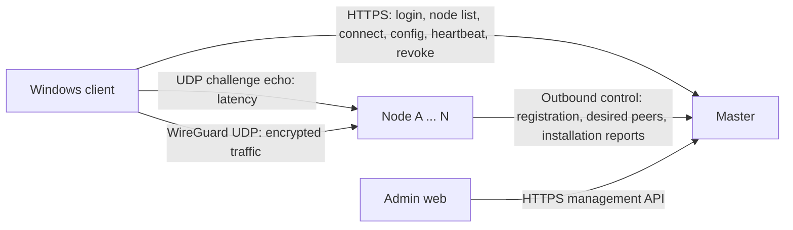

# PMMan 1:N architecture

Development runtime is `ssh txgz`; builds run locally (Windows MSVC and local WSL musl).
The Windows application is Tauri 2/Vue 3 with a privileged Rust sidecar over an ACL-protected Named Pipe.
The admin application is Vue 3/Element Plus, embedded in the Rust master.

## Network boundaries

Clients exchange all account/configuration information only with the master.
Nodes do not run an HTTP listener and never receive user Bearer tokens.
A node owns an exclusive WireGuard interface and its return-route table, plus a separate UDP ping socket.
The master owns identity, authorization, node selection metadata, address allocation and lease lifecycle.
Nodes report their DNS configuration to the master during registration. For new clients the
master produces only the authorized internal CIDRs; the Windows service adds its versioned,
validated dual-stack cnipgen overseas snapshot when split mode is selected. Legacy clients that
do not advertise this capability continue to receive the old node-provided split prefixes.
Node pmmandns domain routing remains independent from client IP route selection.

The master also owns a versioned node resource directory. Node bootstrap scripts download the
current `pmman-node` artifact over authenticated HTTPS using a node-bound token. An administrator
can set a node's desired resource version from the admin panel; the node fetches and verifies the
artifact during its next heartbeat, atomically replaces its own binary, and restarts its project-
scoped systemd unit. Nodes never expose an HTTP management endpoint and the master never SSHes into
nodes.

The planned port-forwarding module keeps resource allocation and lease state on the master while
nodes execute the data plane. An entry is a public address on a node with an independent port pool.
The allocation key is `(entry_id, public_port)`: TCP and UDP on the same entry/port share one user
quota, while the same numeric port on different entries is independent. All nodes are treated as
mutually routed members of the same internal network, so an entry node can route directly to any
client address. See [PORT-FORWARDING.md](PORT-FORWARDING.md).

## Connection sequence

1. Double-click the release client; Windows UAC elevates it and the sibling sidecar starts without a console.
2. Login and obtain node candidates from the public HTTPS master.
3. The sidecar probes each candidate's `probeEndpoint` with UDP. It sends three 24-byte challenges,
   validates both the source socket and an unpredictable per-packet nonce, and uses the median successful RTT.
   Each sample times out after 400 ms; up to 16 nodes are probed concurrently.
4. Automatic selection chooses the lowest reported RTT; manual selection validates the chosen candidate.
   A probe is a reachability/latency observation, never proof of a WireGuard connection.
5. On Connect, generate a fresh keypair locally and send only its public key, node ID and traffic modes to
   `POST /v1/client/connections` on the master.
6. The master authenticates/authorizes, validates the chosen healthy node and route policy, reuses or allocates
   the user's dual-stack lease, and creates a new `config_version` for every connection attempt.
7. The node's outbound one-second reconciliation loop fetches its desired active peers. It removes stale
   kernel/memory peers, installs the correct public key and host routes, and reports exact device ID/key/version.
8. The master releases the configuration only after that exact installation report and matching return-route
   table are present. Missing reports time out after eight seconds; install errors/timeouts revoke the attempt.
9. The sidecar installs WireGuard for Windows, triggers tunnel traffic and validates a fresh handshake
   for this connection. Only then does it expose `state=connected,tunnelMode=wireguard`.

## APIs and lifecycle

| Caller | Master API | Credential |
| --- | --- | --- |
| Client | `/v1/auth/login`, `/v1/client/nodes`, `/v1/client/connections` | User Bearer after login |
| Client | `/v1/devices/{id}/config`, `/heartbeat`, `/revoke` | Owning user's Bearer |
| Node | `/v1/nodes/register`, `/v1/nodes/{id}/heartbeat` | ID-bound node token |
| Administrator | `/v1/admin/*` | Administrator Bearer |

Old node-scoped device proxy APIs have been removed. The legacy single-gateway registration API remains
on the master for the original gateway model; the packaged 1:N client uses `/v1/client/connections`.

Client heartbeats go directly to the master every ten seconds. Revoke is authenticated against both account
and current public key. The master marks the desired state revoked and waits up to three seconds for a fresh
node report confirming removal: 204 means confirmed, 202 means queued while the node is unavailable.
The Windows tunnel is removed either way; healthy nodes reconcile pending cleanup.
Admin revoke/disable also update desired state. User-token expiry/revocation removes the Windows tunnel on heartbeat.

Node reconciliation treats the dedicated kernel WireGuard interface as authoritative local state.
It removes extra keys after either process restarts, preventing orphaned peers; each node therefore requires
its own interface. Return-table migration removes old routes before installing new ones.
Fresh successful installation reports include the current generation; a previous acknowledgment cannot
release a new attempt even when the key is reused.

## Node onboarding and deployment

Administrators create pending nodes and download an ID-bound one-click deployment script. The script
downloads the versioned node resource from the master, verifies its SHA-256, writes the systemd
environment file, and starts the node. The node creates its dedicated WireGuard interface and private key on
first start; the private key never leaves the node. Node registration validates the public key generated from
that local key, the WireGuard endpoint, UDP probe endpoint and route data. First heartbeat establishes liveness;
15 seconds without a heartbeat marks a node offline. Pending, offline and disabled nodes are excluded.

Node environment uses `PMMAN_NODE_ID`, `PMMAN_NODE_TOKEN`, `PMMAN_MASTER_URL`,
`PMMAN_PROBE_ENDPOINT`, `PMMAN_PROBE_LISTEN`, `PMMAN_WG_INTERFACE`,
`PMMAN_WG_PRIVATE_KEY_FILE`, `PMMAN_WG_IPV4_ADDRESS`, `PMMAN_WG_IPV6_ADDRESS`,
`PMMAN_WG_ENDPOINT`, and optional routing/DNS settings. `PMMAN_WG_SERVER_PUBLIC_KEY`
is a retired input; the node derives the public key from its local private key during startup.
`PMMAN_NODE_ENDPOINT` and `PMMAN_NODE_LISTEN` are retired.
The master/node control connection uses HTTPS across hosts; the co-located txgz agents use loopback HTTP.

Only the master exposes public HTTPS (`https://network.pmman.tech`). TXGZ-A/B expose WireGuard UDP
51830/51831 and UDP probes 51840/51841. Old node HTTPS listeners on 8444/8445 have been removed.
See [NODE-ONBOARDING.md](NODE-ONBOARDING.md) and [PUBLIC-DEMO.md](PUBLIC-DEMO.md).

## Addresses and persistence

Default pools are `10.88.0.0/24` and `fd88:1000::/64`; first assignment is
`10.88.0.10/32` and `fd88:1000::a/128`. Exclude IPv4 subnet/broadcast and offset-one gateway addresses.
IPv6 has no broadcast; paired allocations reserve offsets zero/one. Default client capacity is 253.
The production master runs in the project Docker Compose stack beside PostgreSQL. Durable master data
(users, nodes, devices, address leases, network settings, P2P directory state, releases, port forwards
and audit events) is stored in PostgreSQL. Installation reports and short-lived sessions are runtime
state; a restart requires fresh authorization and node heartbeats. Binary release payloads and geosite
data remain in mounted filesystem directories, with their metadata recorded in PostgreSQL.

The legacy JSON stores and `port-forward.db` are accepted only by the one-shot migration tool. The
running master never falls back to them or regenerates defaults when PostgreSQL is unavailable.

Follow-up work includes persistent identity/leases, production authentication, a signed installer and a registered
Windows Service. IPv6 public egress and cross-host failover have not yet been accepted.
